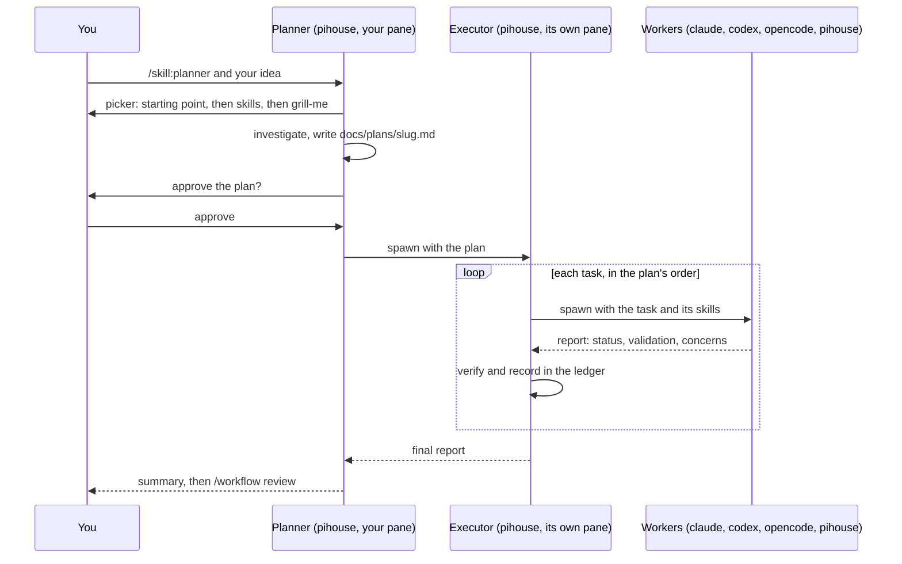
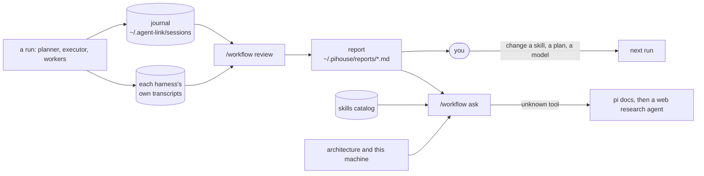
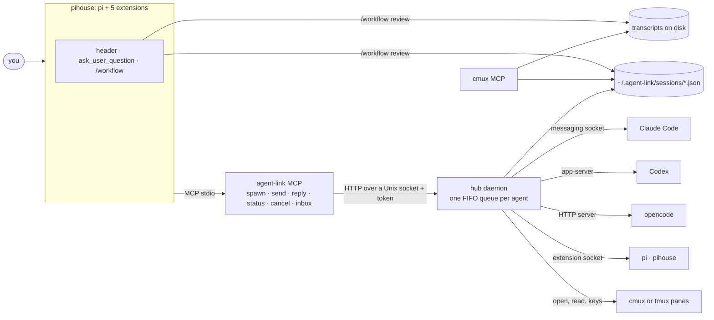

<p align="center">
  <picture>
    <source media="(prefers-color-scheme: light)" srcset="assets/pihouse-light.svg">
    
  </picture>
</p>

<h1 align="center">pi-house</h1>

<p align="center"><strong>Bring light to your agents.</strong></p>

<p align="center">
  A self-learning, lightweight, inter-harness coding agent built on top of <a href="https://github.com/earendil-works/pi">pi</a>.<br>
  It leverages cmux and tmux to run every agent in its own pane.
</p>

<p align="center">
  <a href="https://github.com/Jero110/pi-house/actions/workflows/ci.yml"></a>
  
  
</p>

<p align="center">
  <a href="#install">Install</a> ·
  <a href="#use">Use</a> ·
  <a href="#the-workflow">Workflow</a> ·
  <a href="#self-learning">Self-learning</a> ·
  <a href="#skills">Skills</a> ·
  <a href="#the-mcp-servers">MCP servers</a> ·
  <a href="#architecture">Architecture</a> ·
  <a href="#faq">FAQ</a>
</p>

---

- **Inter-harness.** pi-house plans with you, then hands the plan to other agents (Claude Code, Codex, opencode, more
  pi-house sessions), each in its own pane with its native UI. They talk through agent-link without anyone waiting or polling.
- **Self-learning.** Every run is journaled. `/workflow review` reads what each agent did (tasks, skills, tokens,
  time per message) and recommends what to change in your skills, plans and agent choices; `/workflow ask` answers
  about your setup and researches the tools you name.
- **Lightweight.** pi unmodified, five extensions, two MCP servers with no third-party dependencies, about 10k lines
  of TypeScript that Node runs as is (no build step), and 23 skills as plain Markdown.

## Install

```bash
curl -fsSL https://raw.githubusercontent.com/Jero110/pi-house/main/install.sh | bash
```

The installer asks one question, **cmux or tmux**, and sets up the rest:

- `pih` and `agent-link` in `~/.local/bin`, the code in `~/.pihouse/src`.
- The agent-link MCP server registered with every harness it finds (Claude Code, Codex, opencode, pi, pihouse).
- With cmux, also the cmux MCP server. With tmux, only agent-link.
- pi-house's own pi config in `~/.pihouse/agent`, reusing your pi login. No default provider or model: pi-house starts on the provider you are logged in to.

Skip the question with `bash -s -- --backend cmux` (or `tmux`). Whatever is missing is installed first: Node.js 24,
git, and tmux if you choose it (with Homebrew on macOS, which is installed too if needed; with apt on Ubuntu, Debian
and WSL). `--no-deps` skips that step. cmux comes from [cmux.com](https://cmux.com) (macOS).

The Claude bridge is opt-in: add `--claude-bridge` (`bash -s -- --claude-bridge`) and, when Claude Code is installed,
setup adds it so pi-house can run Claude models on your Claude login. They show up in `/model`; they are never the default.

> **Check Anthropic's terms before you enable it.** The bridge runs Claude through your Claude Code subscription login.
> Anthropic's [Consumer Terms](https://www.anthropic.com/legal/consumer-terms) (section 3) restrict automated access
> "except when you are accessing our Services via an Anthropic API Key or where we otherwise explicitly permit it", and
> its policy on third-party tools using Pro and Max logins has been changing in 2026. Use it only if you have checked
> that it is allowed for you. An API key (`/login`, "API key") is the route that does not depend on that.
`--with-harnesses` installs Claude Code, Codex and opencode first (into `~/.local`):

```bash
curl -fsSL https://raw.githubusercontent.com/Jero110/pi-house/main/install.sh | bash -s -- --with-harnesses
```

### Windows

pi-house needs a Unix shell, Unix sockets and tmux, so on Windows it runs inside WSL2 (Ubuntu). In PowerShell:

```powershell
irm https://raw.githubusercontent.com/Jero110/pi-house/main/install.ps1 | iex
```

The first time, it installs WSL2 with Ubuntu (Windows asks for administrator rights and a restart); open Ubuntu once
to create your user, then run the same command again. The second run installs git, tmux, Node.js 24 and pi-house inside
Ubuntu, with the tmux backend. To install Claude Code, Codex and opencode there as well:

```powershell
& ([scriptblock]::Create((irm https://raw.githubusercontent.com/Jero110/pi-house/main/install.ps1))) -WithHarnesses
```

Then open Ubuntu, run `tmux`, `cd` into a project under your Linux home (`~/`, much faster than `/mnt/c`) and run
`pih`. CI runs this Linux install on a fresh Ubuntu and checks that the PowerShell script parses; the WSL steps
themselves have not run on a Windows machine yet.

## Use

```bash
cd your-project
pih
```

Then ask for what you want, or start the workflow explicitly:

```
/skill:planner a small CLI that tracks my reading list
```

| Command | What it does |
| --- | --- |
| `/skill:planner <idea>` | Plans with you, then hands the plan to an executor agent. |
| `/workflow review` | What the last run did: tasks, agents, skills, tokens and time by role, harness and message, then recommendations. |
| `/workflow ask <question>` | Answers about your workflow, skills and setup; researches tools you name. |
| `/skill:<name>` | Runs any skill by hand, e.g. `/skill:code-review-and-quality`. |

Every pi option and command works too (`pih --model ...`, `/model`, `/login`).

### The interface

pi-house runs pi in a quiet black, white and gray theme with one lilac accent, and replaces pi's footer with a single status
line:

```
~/project · main · claude sonnet-5-5 · ctx ▰▰▱▱▱▱▱▱ 23% · 5h 12% ↻4h16m  7d 3% ↻5d2h
```

It always shows the account you are on: folder, git branch, provider and model, the context window, and the usage windows
of that login. Log in with Claude and it shows Claude's 5 hour and 7 day windows; switch to a ChatGPT model with `/model`
and it shows that account's; on a login or key without windows it shows the session's tokens and cost instead. Narrow
terminals drop the least important parts first. Both live in `packages/pihouse` (`themes/pihouse.json`,
`src/extensions/statusbar.ts`).

## The workflow



The **planner** asks every question in a picker (`ask_user_question`), not in chat. The skills picker
(`pick_skills`) is built from the catalog, so it always shows every development skill; the planner recommends the
few that fit the work (using each one's `offerWhen` in `skills/catalog.json`), and puts only
the ones you pick into the plan. The plan names, for each
task, the agent, harness and model, its skills, what can run in parallel and what waits.

The **executor** never asks you anything: it decides, records its assumptions, runs every task on the agent the plan
names, verifies, integrates, and reports. No skill fixes a model; the plan does, from what you asked for.

**The layout** is the same in cmux and in tmux, in the window you started in, with no tabs: when the executor takes
over, the planner's pane closes and the executor stays on the left at full height; every agent it launches opens in
one column to its right, the column split evenly, and it closes up again as the executor closes finished agents.

```
┌──────────────┬──────────────┐
│              │ w1 · opencode│
│              ├──────────────┤
│   executor   │ w2 · codex   │
│              ├──────────────┤
│              │ w3 · claude  │
└──────────────┴──────────────┘
```

## Self-learning



pi-house learns from what already exists on disk; it adds no tracking of its own.

1. **Record.** The hub journals every agent it opens: parent, task, harness, model, pane, and the path of the
   harness's own transcript.
2. **Measure.** `/workflow review` rebuilds the run from the journal, assigns roles from its shape (the root plans, the
   `executor` runs the plan, its children are workers) and reads every transcript with one parser per harness. The
   numbers are computed, not estimated by a model: tokens and time by role, harness, agent and message; skills
   assigned versus loaded; tool errors; the slowest answers.
3. **Recommend.** The session's model reads that report and writes a summary and up to five recommendations, each
   with its evidence (agent and message number) and the file to change: a skill, the plan, or the executor's choices.
   Both are saved in the report.
4. **Decide.** You apply what you agree with. pi-house does not rewrite your skills by itself.

`/workflow ask <question>` gives the model the architecture, the skills catalog, what is installed on this machine
and the last report. When the question names something it does not know, it searches pi's own docs and examples first,
then sends an opencode agent to the web, and ends with one verdict: we already have something better, it is about the
same as something we have, or it is worth trying (what to change, and on which past task to test it).

## Skills

Four groups. Pre-build and build run inside the workflow; post-build and extras are yours to invoke.

| Group | Skills |
| --- | --- |
| **Pre-build** | `planner` (pihouse), `grilling` (Matt Pocock): the grill-me step |
| **Build** | `executor` (pihouse); development skills (Addy): `test-driven-development`, `spec-driven-development`, `source-driven-development`, `security-and-hardening`, `performance-optimization`, `doubt-driven-development`, `constraint-driven-development`, `documentation-and-adrs`, `observability-and-instrumentation`, `incremental-implementation`, `git-workflow-and-versioning`, `ci-cd-and-automation` |
| **Post-build** | `shipping-and-launch` (Addy), `handoff` (Matt Pocock) |
| **Extras** | `api-and-interface-design`, `browser-testing-with-devtools`, `code-review-and-quality`, `debugging-and-error-recovery`, `code-simplification` (Addy); `impeccable` (Paul Bakaus) |

How skills load:

- Only `planner` and `executor` are visible to the model on their own. Every other skill carries
  `disable-model-invocation: true`, so it loads only when a plan names it or you call `/skill:<name>`.
- The planner shows every development skill in one picker, the ones whose `offerWhen` (in `skills/catalog.json`)
  fits the work first, marked recommended, and writes only the ones you pick into the plan, next to each task.
- The executor passes each task its skills by absolute path, and pi-house lets every worker read the skills folder without
  a permission prompt. `/workflow review` then checks which of them each agent really loaded.

The full catalog, with what each one does and its source: [skills/README.md](skills/README.md). Third-party skills keep
their licenses ([skills/LICENSES](skills/LICENSES/README.md)).

## When an agent stops halfway

Every agent agent-link launches is journaled in `~/.agent-link/sessions/`: who launched it, its task, its pane, its
session id and transcript path. Nothing depends on the hub or the agent still running.

- From any agent in cmux, ask in plain words ("what did the claude in the right pane get done?"): the cmux MCP's
  `list_agent_sessions` and `read_agent_transcript` find the session and read its transcript, never the screen.
- From a shell, anywhere: `agent-link sessions`, then `agent-link transcript <name>`.

So a Codex session can pick up where a stopped Claude Code session left off.

## The MCP servers

Both are plain MCP servers over stdio, so any harness can use them, not only pihouse. The installer registers them with
every harness it finds.

### agent-link

Lets an agent launch other agents and talk to them. Each agent runs in a pane with its own UI; the hub reaches it by
that harness's native interface (Claude Code's messaging socket, Codex's app-server, opencode's HTTP server, pi's
extension socket), never by typing into the screen.

| Tool | What it does |
| --- | --- |
| `spawn` | Opens a worker of a harness (claude, codex, opencode, pi, pihouse) with a task, a model and a folder, in the column right of the caller's pane. Returns at once. With `handoff: true` the new agent takes over: the caller's pane closes once its turn ends. |
| `send` | Sends a message to the caller's parent or one of its workers. A parent's message reads like the user's. |
| `permit` | Answers a permission or question a worker waits on, at any time: the parent gets its numbered options and picks one. opencode is answered through its API, Claude through a PermissionRequest hook; never by reading or typing into the pane. |
| `reply` | Sets the result explicitly; otherwise the last answer of the turn is the result. |
| `status` | The tree of agents and their state: starting, working, asking, done, exited. |
| `cancel` | Stops a worker and closes its pane. |
| `inbox` | For a root that cannot be woken (a plain shell), the results and questions waiting for it. |

A worker's final answer reaches its parent as a new message, so no agent waits or polls. CLI:
`agent-link status | stop | sessions | transcript <agent> | open <harness> | install | uninstall`.

### cmux MCP (cmux only)

Finds and reads agent sessions, arranges cmux and drives its browser.

| Area | Tools |
| --- | --- |
| Agent sessions | `list_agent_sessions`, `read_agent_transcript`: every agent session on this machine (cmux's records joined with the agent-link journal), and its transcript read from disk, never from the screen |
| Tabs and panes | `list_surfaces`, `new_surface`, `close_surface`, `focus_surface`, `rename_tab`, `move_surface`, `reorder_surface`, `surface_health`, `new_pane`, `resize_pane`, `swap_pane` |
| Workspaces | `list_workspaces`, `current_workspace`, `select_workspace`, `new_workspace`, `rename_workspace`, `close_workspace` (shows the contents first, asks before closing running agents), `tree`, `identify` |
| Browser | `browser`: navigate, snapshot, click, type, wait, tabs, console, screenshots |

## Architecture



Every agent runs in its own pane with its native UI, and the hub reaches it by that harness's own interface, not by
typing into the screen. Nobody waits: `spawn` and `send` return at once, and a worker's final answer arrives in its
parent as a new message. The journal records every agent (parent, task, pane, session id, transcript path), so the
cmux MCP and `/workflow review` work after the hub or the agents are gone.

| Package | What it is |
| --- | --- |
| [`packages/pihouse`](packages/pihouse) | the `pih` command: launcher, setup, extensions (header, status bar, `ask_user_question`, `/workflow`, the Claude Code login) |
| [`packages/agent-link-core`](packages/agent-link-core) | hub daemon, one adapter per harness (claude, codex, opencode, pi), MCP server, guard, session journal |
| [`packages/agent-link`](packages/agent-link) | the composed hub and the `agent-link` CLI (`status`, `sessions`, `transcript`, `install`) |
| [`packages/agent-link-cmux`](packages/agent-link-cmux) | cmux pane backend and its MCP entry |
| [`packages/agent-link-tmux`](packages/agent-link-tmux) | tmux pane backend and its MCP entry |
| [`packages/agent-transcripts`](packages/agent-transcripts) | one reader for Claude, Codex, opencode, pi and pihouse transcripts: messages, tokens, time, tools, skills |
| [`packages/cmux-mcp`](packages/cmux-mcp) | the cmux MCP server: agent sessions, tabs, panes, workspaces, browser |
| [`skills`](skills) | the four skill groups and their catalog |

How the pieces fit, in detail: [docs/architecture.md](docs/architecture.md).

## FAQ

**Why pi, and not a harness of its own?**
pi is small and its extension API gives pi-house everything it needs (tools, commands, messages that start a turn, the
header) without a fork. pi-house pins pi and keeps its own config in `~/.pihouse/agent`, so your plain pi stays as it is.

**Do I need cmux?**
You need cmux or tmux, because every agent gets its own pane. cmux adds the cmux MCP (sessions, layout, browser); with
tmux you get agent-link alone. cmux is macOS only; on Linux and on Windows (through WSL2) use tmux.

**Does it run on Windows?**
Through WSL2, with tmux: `install.ps1` sets it up (see [Windows](#windows)). Natively, no: the hub and the adapters use
Unix sockets, and the guard reads shell commands, not PowerShell.

**What does it cost?**
What each harness spends with its provider. pi-house calls no model on its own; `/workflow review` shows the tokens per
role, harness, agent and message. opencode defaults to a free model.

**What does pi-house keep, and where?**
`~/.pihouse`: pi-house's pi config, sessions and `/workflow` reports. `~/.agent-link`: the hub socket and token, the event log,
the session journal and the profiles. Nothing leaves your machine except what each harness sends to its own provider.

**Is it safe to leave several agents running?**
A guard checks shell commands: workers are blocked from `rm -rf`, `sudo`, `git push`, `git reset --hard` and similar,
and your own session is asked first. It is not a sandbox, and it only sees shell commands.

**Can workers launch their own workers?**
Yes: the executor is one. A worker talks only with its parent and its own workers.

## Develop

```bash
git clone https://github.com/Jero110/pi-house && cd pi-house
npm install --ignore-scripts
npm run check && npm test
bash install.sh            # installs from this checkout
```

Rules for contributors (and their agents) are in [AGENTS.md](AGENTS.md) and [CONTRIBUTING.md](CONTRIBUTING.md). Tests never
call real models. Security reports go through [SECURITY.md](SECURITY.md); everyone is expected to follow the
[Code of Conduct](CODE_OF_CONDUCT.md).

## Uninstall

```bash
pih uninstall             # removes the MCP registrations and the pihouse profile
rm -rf ~/.pihouse ~/.local/bin/pih ~/.local/bin/pihouse ~/.local/bin/agent-link
```

## Credits

pi-house stands on [pi](https://github.com/earendil-works/pi) by Earendil Works and ships skills by Addy Osmani, Matt
Pocock and others (see [skills/LICENSES](skills/LICENSES/README.md)). It started as Faro.

## License

MIT. Third-party skills under [skills/LICENSES](skills/LICENSES/README.md) keep their own licenses.
