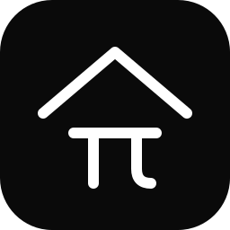
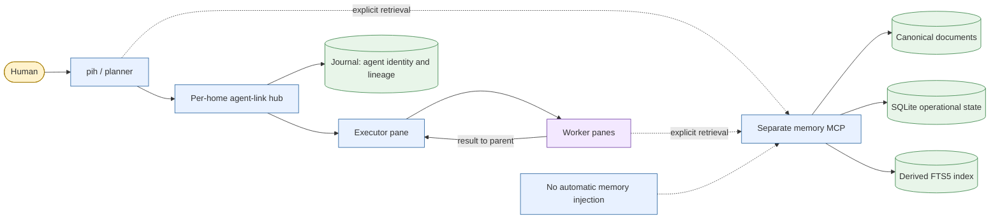
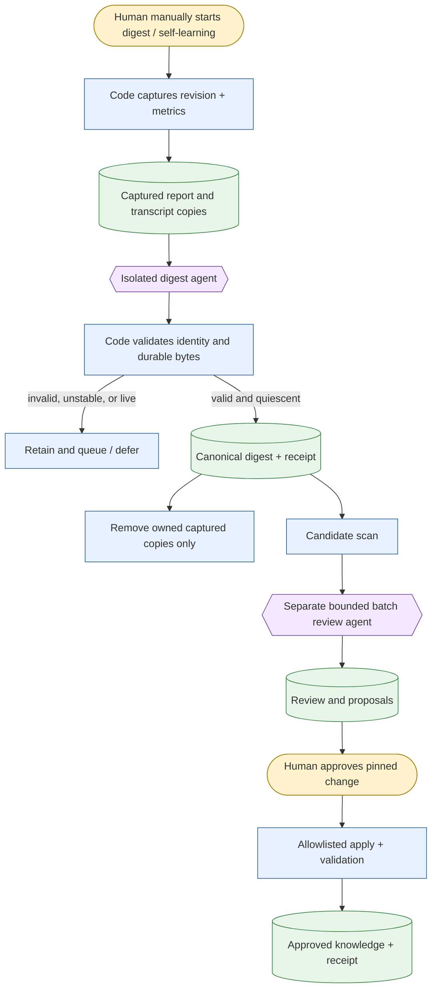
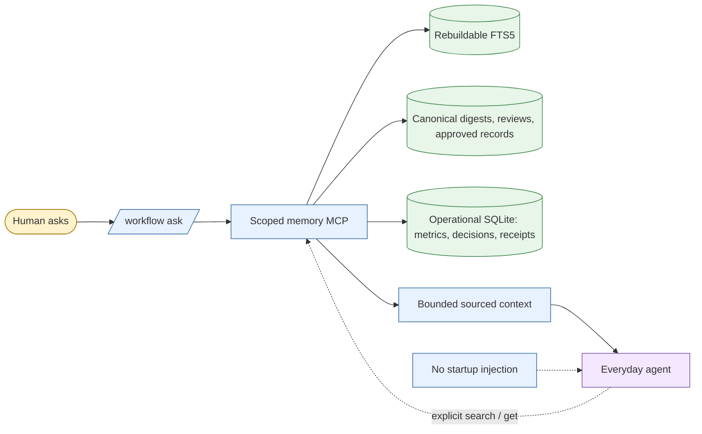
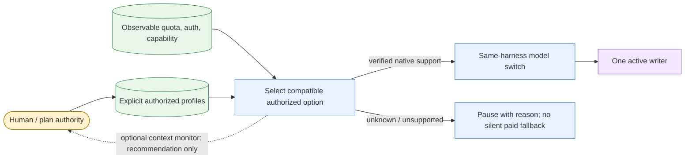

<p align="center">
  <picture>
    <source media="(prefers-color-scheme: light)" srcset="assets/pihouse-light.svg">
    
  </picture>
</p>

<h1 align="center">pi-house</h1>

<p align="center">
  A lightweight, inter-harness coding agent built on unmodified <a href="https://github.com/earendil-works/pi">pi</a>.<br>
  It plans with you and runs agents in their own cmux or tmux panes.
</p>

<p align="center">
  <a href="https://github.com/Jero110/pi-house/actions/workflows/ci.yml"></a>
  
  
</p>

## Install

```bash
curl -fsSL https://raw.githubusercontent.com/Jero110/pi-house/main/install.sh | bash
```

The installer asks whether to use cmux or tmux and installs `pih`, agent-link, and isolated pi-house configuration. To choose cmux without a prompt:

```bash
bash -s -- --backend cmux
```

Node.js 24+, git, and tmux (when selected) are installed if missing. See [Windows/WSL](#windows) for Windows setup. The optional Claude bridge is enabled with `--claude-bridge`; review provider terms and account policy before using subscription-backed access.

## Use

```bash
cd your-project
pih
```

Start a plan with `/skill:planner <idea>`, or use the workflow commands directly:

| Command | What it does |
|---|---|
| `/workflow report [--last]` | Writes a code-computed Markdown report and returns its path. Active work is labeled partial. It does not call a model or enroll the session. |
| `/workflow save [reason]` | Captures an otherwise unselected conversation for learning. |
| `/workflow digest` | Manually generates missing digests in separate agents for eligible evidence. |
| `/workflow self-learning` | Prepares missing digests, scans and reviews a batch in separate agents. Does not apply proposals. |
| `/workflow ask <question>` | Selectively consults retained workflow evidence, metrics, architecture and skills. |
| `/workflow proposals` | Lists proposed changes and their evidence/status. |
| `/workflow approve <id>` | Approves the displayed proposal version and attempts its validated application. |
| `/workflow reject <id> [reason]` | Records rejection and its reason. |
| `/skill:<name>` | Invokes a skill manually, e.g. `/skill:code-review-and-quality`. |

`/workflow review`, `/keeper`, and `pih keeper` are retired and return concise guidance; they are not aliases. Digest and review require an agent-link-enabled pihouse session. The initiating conversation gets short status and paths, not full generated output. Approval never means a proposal was silently or automatically applied.

## Self-learning and data

Planner/executor runs are selected automatically; other conversations require `/workflow save`. Reports and structured metrics are computed by code. Digesting and cross-run review are explicit, isolated model work. Unstable or unverifiable runs are deferred. Validated digest cleanup can remove only pi-house-owned captured conversational copies; it does not delete native harness sessions, repository files, or migration backups. Summaries can omit detail, and the system does not claim lossless transcript replacement.

Canonical knowledge remains readable documents. SQLite is authoritative for operational jobs, metrics, decisions and receipts; FTS5 is a rebuildable derived index, not the operational database. Everyday agents receive retrieval tools and a short instruction, not automatically injected memories. Routing uses explicit authorized profiles; unsupported or unknown availability pauses rather than silently enabling a paid fallback. Native model switching is limited to verified same-harness support. Optional context monitoring is opt-in and recommendations require manual application.

Legacy migration is explicit, not an automatic startup action. It creates a verified `migration-backup/` before importing. Snapshot and restore guidance, API limitations, and retention boundaries are in [Workflow self-learning](docs/self-learning.md). The detailed contracts are in [module specifications](docs/specs/self-learning/common.md); historical rationale remains in [ADR-001](docs/decisions/ADR-001-workflow-memory.md), with current decisions in [ADR-002](docs/decisions/ADR-002-self-learning.md).

## Architecture

All diagrams use the same legend: blue = code/policy, purple = LLM processing, green = stored data, yellow = human action.

### Communication and ownership



### Evidence to learning



### On-demand memory



### Quota-aware routing



The [architecture guide](docs/architecture.md) explains responsibility boundaries and limitations. These diagrams distinguish code decisions, model work, persistent state, and human authorization; they do not claim universal quota visibility or cross-harness fenced continuation.

## Skills

Skills are plain Markdown organized in pre-build, build, post-build and extras groups. The [catalog](skills/README.md) lists them and their sources. The planner recommends development skills; selected skills are carried into the plan and executor tasks.

## MCP servers

**agent-link** launches and messages workers through native harness interfaces and journals their lineage. **cmux MCP** (cmux only) finds sessions and arranges panes/workspaces. Both use stdio; see [Architecture](docs/architecture.md) for package responsibilities and tool details.

## Windows

pi-house requires Unix sockets and a Unix shell. On Windows, use WSL2 with tmux:

```powershell
irm https://raw.githubusercontent.com/Jero110/pi-house/main/install.ps1 | iex
```

Open Ubuntu, then run `pih` from a project under the Linux home directory. See the [installer](install.ps1) for options.

## Develop

```bash
git clone https://github.com/Jero110/pi-house && cd pi-house
npm install --ignore-scripts
npm run check && npm test
```

See [AGENTS.md](AGENTS.md), [CONTRIBUTING.md](CONTRIBUTING.md), and [SECURITY.md](SECURITY.md).

## Uninstall

```bash
pih uninstall
rm -rf ~/.pihouse ~/.local/bin/pih ~/.local/bin/pihouse ~/.local/bin/agent-link
```

## License

MIT. Third-party skills retain their licenses; see [skills/LICENSES](skills/LICENSES/README.md).
