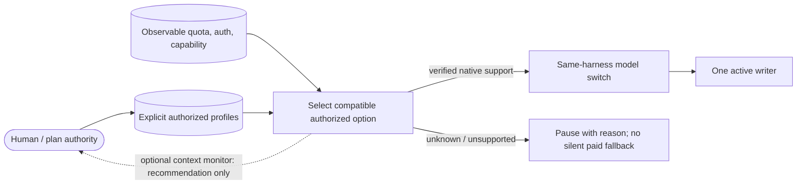

<p align="center">
  <picture>
    <source media="(prefers-color-scheme: light)" srcset="assets/pihouse-light.svg">
    
  </picture>
</p>

<h1 align="center">pi-house</h1>

<p align="center">
  <b>Your harness should be an extension of you.</b><br>
  A multi-harness, multi-model coding agent built on unmodified <a href="https://github.com/earendil-works/pi">pi</a>,<br>
  that plans with you, runs agents in cmux panes and learns how you work.
</p>

<p align="center">
  <a href="https://github.com/Jero110/pi-house/actions/workflows/ci.yml"></a>
  
  
</p>

## Why pi-house

AI moves every day: new models, new harness releases, new plugins. You end up switching between models and harnesses all the time, and that is a pain. pi-house is built so you stop paying that cost.

- **Multi-harness, multi-model.** An agent runs on its own harness, and it can hand any task to another harness (Claude Code, Codex, opencode, pi) and pick whichever model you have available for it. You choose the best tool per task instead of living inside one vendor.
- **Native agent-to-agent communication.** Protocols like ACP exist, but no single one is accepted by every provider. So pi-house uses a terminal multiplexer (cmux, or tmux) as the common ground: each agent lives in its own pane and talks to the others through the agent-link hub. It works with any harness that can run in a terminal.
- **A harness that knows you.** Your harness should know your workflow end to end. Everything is open source (pi, cmux) and configurable, so you can ask it things like *"the new vision models just came out, would they fit my workflow, and how?"* or hear *"you spend a lot of tokens here, on these MCPs and these skills"*.
- **Only what you use.** More is not better. pi-house keeps in your harness what you actually use, on top of pi, the most minimal and configurable harness there is.

## Self-learning

Your skills, MCPs, prompts and the way your agents talk to each other should keep improving. This is not a closed loop: it is a watcher that analyzes your tokens, skills, prompts and usage and proposes concrete fixes, always approved by you:

- *"Your agents are not communicating well."*
- *"You call a bigger model than needed here and burn many tokens."*
- *"This skill is almost never used, but it is always read into context."*
- *"A new skill would make this step much safer."*

How it works, briefly: everything flows through the **hub**. Code computes reports and metrics, an isolated agent writes a **digest** per session, and a separate agent **reviews them in batches** and produces proposals. Nothing is applied until you approve it.

## Plan, then execute: no more "yes monkeys"

pi-house gets rid of the agent that makes you sit in front of it pressing "yes, accept, do it". Work runs in two phases:

1. **Planning** is deliberately exhaustive. You and the agent agree on exactly what will be built before anything is written (`/skill:planner`).
2. **Execution** is clean and automatic (`/skill:executor`). You can step away: permissions are handled, and agents that are no longer needed are spawned and killed on their own through the agent-link MCP, which lets agents run other agents automatically.

## Books RAG

LLMs are still not great at system design, and there are incredible resources out there: books. pi-house ships a built-in RAG over your private PDF library so you can bring that knowledge into your design, and even do **RAG-driven development** that relies only on your sources, not on the model's memory. Use `/skill:ask-books <question>`, or let the `rag-based-development` skill ground your plan.

## Also included

- **Quota-aware model choice.** On a fresh start, pi-house can pick an authenticated Claude or OpenAI-Codex model that your subscription quota confirms has room. If quota is unknown it warns, and it never silently falls back to a paid model.
- **Workflow commands.** `/workflow ask` answers questions about your own setup (tokens, MCPs, skills, architecture), `/workflow report` writes a code-computed report, and `/workflow proposals`, `approve` and `reject` manage self-learning changes.
- **Skills as plain Markdown.** Grouped as pre-build, build, post-build and extras. The planner recommends the ones that fit and carries them into the plan and every executor task.
- **Two MCP servers.** agent-link launches and messages workers on any harness and journals their lineage. The cmux MCP finds sessions and arranges panes.
- **On-demand memory.** Agents search retained knowledge only when they need it. Nothing is injected into context automatically.

## Make your own tools

These are some of the tools and ideas of the team, but the point is bigger: stop depending on a single harness or model, and start building and using your own tools.

## Install (macOS)

```bash
curl -fsSL https://raw.githubusercontent.com/Jero110/pi-house/main/install.sh | bash
```

The installer asks whether to use cmux or tmux and installs `pih`, agent-link and an isolated pi-house configuration. To choose cmux without a prompt:

```bash
curl -fsSL https://raw.githubusercontent.com/Jero110/pi-house/main/install.sh | bash -s -- --backend cmux
```

Then:

```bash
cd your-project
pih
```

Start with `/skill:planner <idea>`.

## How it is built

All diagrams use the same legend: blue = code/policy, purple = LLM processing, green = stored data, yellow = human action.

### Communication and ownership


### Evidence to learning


### On-demand memory


### Quota-aware routing



See the [architecture guide](docs/architecture.md) for details.

## License

MIT. Third-party skills retain their licenses; see [skills/LICENSES](skills/LICENSES/README.md).
