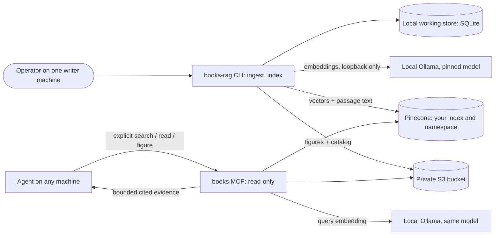

# Architecture

pihouse is three things that stay separate: **pi** (the agent, unmodified), **agent-link** (agents launching and talking to
agents) and the **cmux MCP** (finding sessions and arranging cmux). pihouse itself is a launcher and three pi extensions.

```
 you ─► pihouse (pi + extensions) ── MCP stdio ─► agent-link MCP ── HTTP over a Unix socket ─► hub daemon
                                                                                              ├─ registry, one queue per agent
                                                                                              ├─ adapters: claude, codex, opencode, pi
                                                                                              ├─ pane backends: cmux, tmux
                                                                                              └─ journal: ~/.agent-link/sessions/*.json
        any harness ── MCP stdio ─► cmux MCP ─► cmux CLI, the journal, transcripts on disk
```

## pihouse

`pih` (packages/pihouse) runs pi from its pinned dependency with:

- `PI_CODING_AGENT_DIR=~/.pihouse/agent`: pihouse's own settings, sessions and MCP servers; plain pi stays untouched. The first
  run copies pi's login (auth, model store, the Claude bridge package if you use it) so the same models work.
- `-e` for its extensions: `brand.ts` (header and title), `statusbar.ts` (the footer: folder, model, context and the usage of the account in use; its theme is `packages/pihouse/themes/pihouse.json`), `ask.ts` (`ask_user_question`, and `pick_skills`: the skills picker built from the catalog), `workflow.ts` (`/workflow`).
- The four skill group folders as pi skill paths. Only `planner` and `executor` are visible to the model on their own;
  every other skill carries `disable-model-invocation: true` and loads when a plan or the user names it.

A user's `pih` registers with the agent-link hub as a root of harness `pihouse`; the hub answers with the command to run
(the pihouse profile in `~/.agent-link/profiles/pihouse.json`: this CLI, plus agent-link's pi extension and identity env). When
the hub starts a pihouse worker, the same profile opens it in a pane. Without a hub, pihouse runs as plain pi plus its
extensions.

## agent-link

- **Hub daemon**: one per machine, socket `~/.agent-link/hub.sock` (0600), token `~/.agent-link/token`. Started on demand
  by the MCP server or `agent-link open`.
- **MCP server**: seven tools (`spawn`, `send`, `permit`, `reply`, `status`, `cancel`, `inbox`), one entry per backend
  (`agent-link-cmux`, `agent-link-tmux`). The model never sees adapters.
- **Adapters**, one per harness, each by its native path: Claude Code's messaging socket, Codex's app-server, opencode's
  HTTP server, pi's extension socket. A harness without one can use a `paste` profile.
- **Pane backends**: open, close, read, keys, paste, alive. A caller's workers form one column to its right (the
  first split right of it, each next one below the last still open), never stealing focus and never as tabs; after
  every open and close the layout evens out (cmux `workspace.equalize_splits`, tmux `main-vertical` with the main pane
  at half the width). Opens run one at a time, so parallel spawns stack. A worker always stays in the caller's
  workspace (cmux) or window (tmux), however small its pane: a split that does not fit is retried from the other panes
  there, and the open fails clearly when none does. Agents resize and move panes with the cmux MCP (`resize_pane`,
  `move_surface`, `swap_pane`).
- **Handoff**: `spawn` with `handoff: true` (the planner opening the executor) closes the caller once the new agent is
  connected and the caller's turn has ended, with its pane (a root's own terminal too), while the new agent and its
  workers go on.
- **Messages**: one FIFO queue per agent; the hub prompts an agent only when it is idle, so each message gets its own
  turn and result. A worker's first message is its task, as a person would write it, and its parent's messages arrive
  plain; a message from anyone else starts with `[agent-link] <name>:`. A worker's final answer reaches its parent as
  `[agent-link] <name> (...) finished: ...`.
- **Journal**: on every change the hub writes `~/.agent-link/sessions/<id>.json`: name, parent, root, task, harness,
  model, state, pane, and the harness's own session id and transcript path (reported by the adapters). It outlives the
  hub and the agent, which is what makes recovery and `/workflow review` possible.

Identity reaches a spawned harness through `AGENT_LINK_AGENT`, `AGENT_LINK_HUB`, `AGENT_LINK_TOKEN`,
`AGENT_LINK_DEPTH` and `AGENT_LINK_HOME`. `AGENT_LINK_READ_DIRS` lists folders outside its cwd a worker may read
without a prompt (pihouse shares its skills folder); a profile may add env of its own (pihouse's `PIHOUSE_HOME`). A guard lets workers do normal work, blocks the catastrophic, and asks for the rest.

## cmux MCP

A separate server (`packages/cmux-mcp`) with the tools in the README. Sessions come from two sources joined by session
id: cmux's own records (`cmux sessions`, which work without the cmux socket) and the agent-link journal (which adds
names, tasks, parents and sessions cmux does not see). `read_agent_transcript` reads the transcript file through
`agent-transcripts`; it never reads the terminal screen.

## agent-transcripts

One reader for every harness's session format (Claude Code and Codex JSONL, opencode's SQLite database, pi and pihouse
JSONL) into one shape: messages with role, text, model, token usage, time per answer, tool calls and the skills loaded.

## /workflow

- `review` picks the run of the current session (or `--last`), rebuilds its tree from the journal, assigns roles from
  its shape (the root plans, an `executor` child runs the plan, its descendants are workers), reads every transcript and
  writes a report to `~/.pihouse/reports/`. The numbers are computed; the session's model then writes the summary and the
  recommendations from them.
- `ask` gives the model the architecture, the skills catalog and what is installed here, then the question.

## Books library



The books library is a separate workspace, `packages/books-rag`, not part of the hub or the pihouse extensions. `pih setup` registers its MCP server in pihouse's `mcp.json` by default (`registerBooks`, gated on Node >= 26.11.1, owned only while the entry is unchanged), which only makes the tools callable. Only the writer machine holds the working store and the original PDFs; originals are never uploaded. Readers need the env file, the same local model and the MCP entry, nothing else. Hosted records are verified against a generation-based catalog, so an incomplete publication reads as `incomplete_corpus`, not mixed results. Book text resides in two third-party services and returned evidence can reach the agent's provider. Nothing is ingested or injected at startup. See the [operator guide](books-rag.md) and [ADR-003](decisions/ADR-003-books-rag.md).
