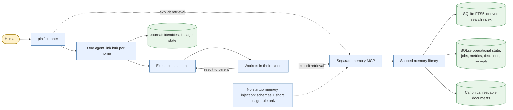
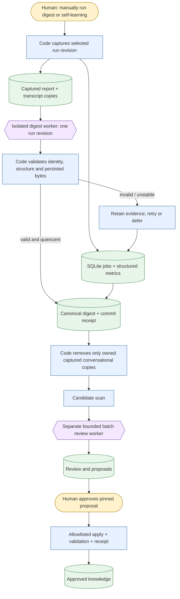
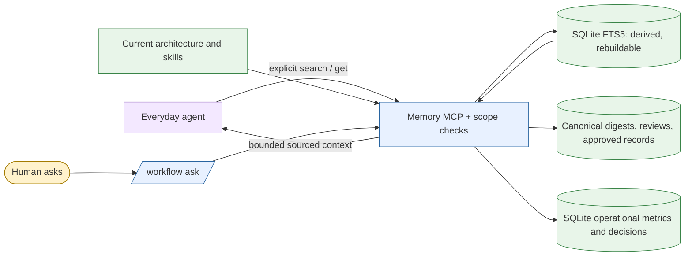
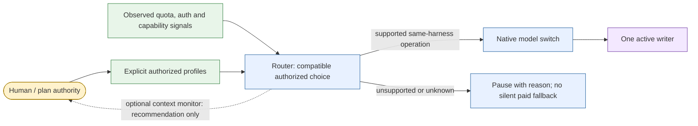

# Architecture

pi-house keeps orchestration, learning, and the underlying pi runtime separate. pi is unmodified. `pih` is the launcher and extension host; agent-link launches and routes messages to agents through harness-native interfaces; a per-home hub journals orchestration state. Workflow evidence and memory are local pihouse services, not hub responsibilities.

## Communication and memory boundary

The hub journals participants and routes work; it does not own memory. Each worker runs through its harness-native interface and has its own pane. Memory retrieval is explicit, scoped, and separate from agent-link routing.

## Evidence to learning

A **report** is code-computed Markdown (partial while work is active); a **transcript** is source conversation; a **digest** is a lossy, validated summary of a stable revision. Digest and review are manually triggered and run in separate agents. Failure or uncertain liveness retains captured copies and queues work. Cleanup never claims to delete native harness sessions, project files, or migration backups. Candidate recommendations are not approved knowledge until a human authorizes the pinned change and validation records a receipt.

## Memory consultation

SQLite's operational tables are authoritative and are not disposable search data. Rebuilding FTS does not rebuild or erase job, metric, decision, or receipt state. Ordinary sessions see no automatic memory bootstrap; `/workflow ask` or explicit MCP retrieval selects bounded material on demand.

## Authorized routing

The MCP `model` tool permits self-targeting or ancestor-to-worker changes using exact configured model IDs. Busy self-switches wait for the next native idle boundary and cannot use `retry` or `interrupt`, avoiding cancellation or replay of their own request. Registered pull roots without adapter-side `setModel` refuse safely.

The router does not imply universal quota visibility. In-place switching is limited to verified native support (pi, pihouse, opencode); other harnesses use the fenced `replace` tool described below, which the router does not trigger automatically. Optional context monitoring is opt-in and requires manual application; no automatic model switch occurs.

## Workflow implementation

`packages/pihouse/src/extensions/workflow.ts` exposes the public command family. Supporting modules under `packages/pihouse/src/workflow/` divide reporting, capture/evidence, migration, storage, search, isolated digest jobs, batch review, proposals and routing. Canonical documents remain readable; the local SQLite store owns operational state and derived FTS. `migrateLegacyStore` is an explicit migration operation, not an automatic startup migration. See the [self-learning guide](self-learning.md), [module specifications](specs/self-learning/common.md), [ADR-001](decisions/ADR-001-workflow-memory.md), and [ADR-002](decisions/ADR-002-self-learning.md).

## Other components

- **pihouse:** `packages/pihouse` runs pinned pi with extensions for identity/title, status, compact tools, workflow commands, account usage, and login integration. Its configuration is isolated under `~/.pihouse/agent`; plain pi is untouched.
- **agent-link:** a local hub, MCP tools, harness adapters, pane backends and journal. A worker result is delivered to its parent; hub lifecycle and memory lifecycle are distinct.
- **Fenced replacement (`replace`):** for a worker whose harness cannot switch its model (Claude Code, Codex, paste), an ancestor fences it, closes it and confirms the exit (record exited and, when its pid is known, the process gone; bounded wait), then starts one replacement in the same folder under the same parent. The replacement gets a continuation built by code: the original task, the old worker's last text as untrusted progress notes (bounded), optional notes, git HEAD/status fingerprints before and after, and lineage; never the transcript. The old worker's children move to the replacement; its late output is dropped with at most one stale notice. An unconfirmed exit spawns nothing, a turn that finished on its own is the outcome, and a concurrent `replace` or `model` interrupt is refused. One writer at a time; live harness permission races are covered only by fake adapters.
- **cmux MCP:** optional tools for cmux sessions, panes, workspaces and browser. It can read transcripts from harness-owned files; it does not manage retention.
- **agent-transcripts:** parsers normalize supported harness transcripts for reporting and selected capture.

For package boundaries, installation and public commands, see [README](../README.md). Historical workflow design remains in [ADR-001](decisions/ADR-001-workflow-memory.md) and the [historical specification](specs/workflow-memory.md); current conflicting decisions are specified in ADR-002.

## Books library

The books library is a separate workspace, `packages/books-rag`, not part of the hub or the pihouse extensions. `pih setup` registers its MCP server in pihouse's `mcp.json` by default (`registerBooks`, gated on Node >= 26.11.1, owned only while the entry is unchanged), which only makes the tools callable. Only the writer machine holds the working store and the original PDFs; originals are never uploaded. Readers need the env file, the same local model and the MCP entry, nothing else. Hosted records are verified against a generation-based catalog, so an incomplete publication reads as `incomplete_corpus`, not mixed results. Book text resides in two third-party services and returned evidence can reach the agent's provider. Nothing is ingested or injected at startup. See the [operator guide](books-rag.md) and [ADR-003](decisions/ADR-003-books-rag.md).
