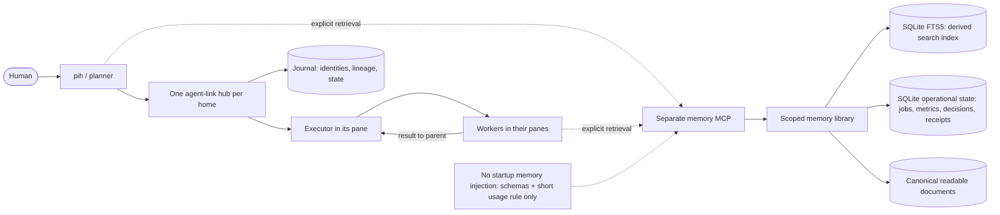
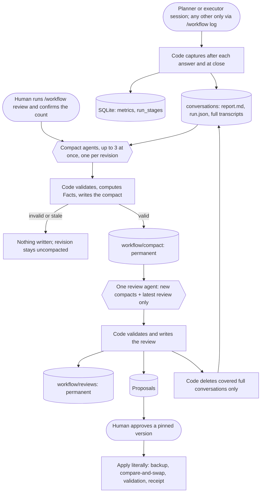
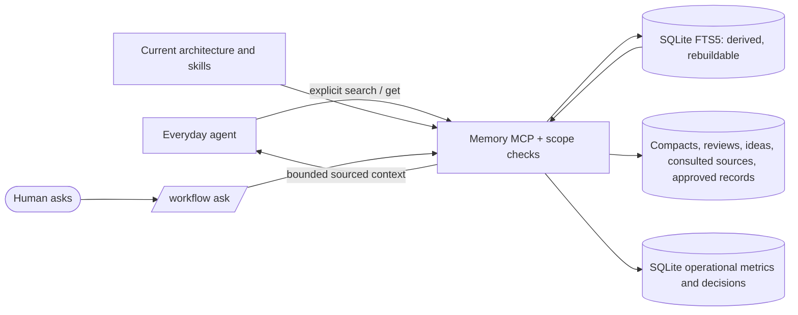
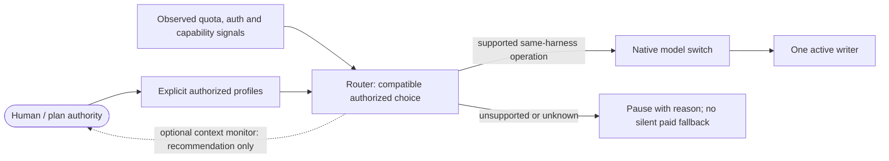
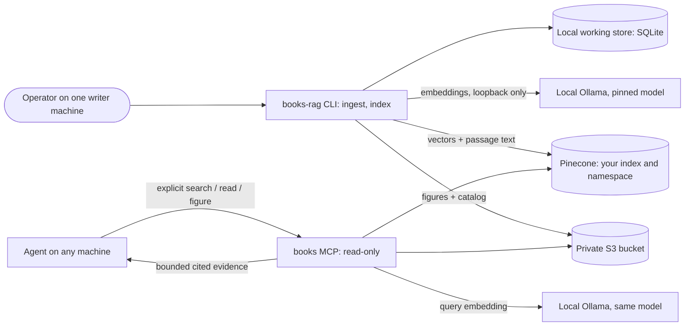

# Architecture

pi-house keeps orchestration, learning, and the underlying pi runtime separate. pi is unmodified. `pih` is the launcher and extension host; agent-link launches and routes messages to agents through harness-native interfaces; a per-home hub journals orchestration state. Workflow evidence and memory are local pihouse services, not hub responsibilities.

## Communication and memory boundary

The hub journals participants and routes work; it does not own memory. Each worker runs through its harness-native interface and has its own pane. Memory retrieval is explicit, scoped, and separate from agent-link routing.

## Evidence to learning

Capture is code and runs no model. A **report** is code-computed Markdown for the human and is no input of compact or review; a **transcript** is the source conversation, kept as a temporary full copy; a **compact** is a validated summary of one revision (at most 6,000 characters) with code-computed Facts; a **review** is one file (at most 12,000 characters) that reads only the new compacts and the previous review and carries the previous essentials forward. Compact and review run in separate agents on the hub and need it. Deletion removes only pi-house-owned copies in `conversations/<run id>/transcripts/`, per run, after its review was written and ingested, the run is quiescent and its evidence fingerprint is unchanged; a compact made by `/workflow ask` never authorizes it. A review that fails halfway keeps every conversation. Nothing deletes native harness sessions, project files, compacts, reviews or migration backups. A proposal is not applied until a human approves its pinned version, and a `file:` proposal may name any existing regular file except credentials. There is no lock between two reviews, and a review input beyond 60,000 characters defers the newest compacts to the next review. See the [self-learning guide](self-learning.md) for the limits.

## Memory consultation

SQLite's operational tables are authoritative and are not disposable search data. Rebuilding FTS does not rebuild or erase job, metric, decision, or receipt state. Ordinary sessions see no automatic memory bootstrap; `/workflow ask` or explicit MCP retrieval selects bounded material on demand. `/workflow ask` answers from **compacts and reviews** (plus ideas and consulted sources) through a keyword search that matches any word, never from a transcript, and its context is capped at 80,000 characters. When saved runs of the current project have no compact it asks once, and only on a yes the `workflow_compact` tool compacts them; ask never deletes a conversation or marks a run reviewed.

## Authorized routing

The MCP `model` tool permits self-targeting or ancestor-to-worker changes using exact configured model IDs. Busy self-switches wait for the next native idle boundary and cannot use `retry` or `interrupt`, avoiding cancellation or replay of their own request. Registered pull roots without adapter-side `setModel` refuse safely.

The router does not imply universal quota visibility. In-place switching is limited to verified native support (pi, pihouse, opencode); other harnesses use the fenced `replace` tool described below, which the router does not trigger automatically. pihouse separately checks supported subscription observations once on a fresh interactive startup and may select a confirmed-available authenticated default alternative; this does not change the saved default or authorize a routing profile choice. CLI `--model`, restored sessions, and later manual `/model` choices take precedence. `/model` remains available, and `Ctrl+S` saves a chosen default. Claude subscription quota is read through Claude Code's experimental SDK `/usage` control request (which calls its usage endpoint without a model prompt); the bridge's status-line files and response headers are fallbacks. OpenAI subscription quota comes from the ChatGPT usage endpoint. Missing, expired, and failed readings never prove availability. Unknown quota is labeled uncertain, all-exhausted states do not trigger an automatic selection, and providers without a supported observation source are not claimed to be quota-available. Optional context monitoring is opt-in and requires manual application; no in-session model switch occurs.

## Workflow implementation

`packages/pihouse/src/extensions/workflow.ts` exposes the public command family. Supporting modules under `packages/pihouse/src/workflow/` divide reporting, capture/evidence, migration, storage, search, compact and review runs, the deletion gate, proposals and routing; `vault-paths.ts` is the only module that knows the vault layout. Canonical documents remain readable; the local SQLite store owns operational state and derived FTS. `migrateLegacyStore` is an explicit migration operation, not an automatic startup migration. See the [self-learning guide](self-learning.md), [module specifications](specs/self-learning/common.md), [ADR-001](decisions/ADR-001-workflow-memory.md), [ADR-002](decisions/ADR-002-self-learning.md), and [ADR-004](decisions/ADR-004-vault-review.md), which defines the current loop and the [vault-review specification](specs/self-learning/vault-review.md).

## Other components

- **pihouse:** `packages/pihouse` runs pinned pi with extensions for identity/title, status, compact tools, workflow commands, account usage, startup model choice, and login integration. Fresh interactive startup can choose another authenticated, confirmed-available subscription model without changing the saved default. Its configuration is isolated under `~/.pihouse/agent`; plain pi is untouched.
- **agent-link:** a local hub, MCP tools, harness adapters, pane backends and journal. A worker result is delivered to its parent; hub lifecycle and memory lifecycle are distinct.
- **Fenced replacement (`replace`):** for a worker whose harness cannot switch its model (Claude Code, Codex, paste), an ancestor fences it, closes it and confirms the exit (record exited and, when its pid is known, the process gone; bounded wait), then starts one replacement in the same folder under the same parent. The replacement gets a continuation built by code: the original task, the old worker's last text as untrusted progress notes (bounded), optional notes, git HEAD/status fingerprints before and after, and lineage; never the transcript. The old worker's children move to the replacement; its late output is dropped with at most one stale notice. An unconfirmed exit spawns nothing, a turn that finished on its own is the outcome, and a concurrent `replace` or `model` interrupt is refused. One writer at a time; live harness permission races are covered only by fake adapters.
- **cmux MCP:** optional tools for cmux sessions, panes, workspaces and browser. It can read transcripts from harness-owned files; it does not manage retention.
- **agent-transcripts:** parsers normalize supported harness transcripts for reporting and selected capture.

For package boundaries, installation and public commands, see [README](../README.md). Historical workflow design remains in [ADR-001](decisions/ADR-001-workflow-memory.md) and the [historical specification](specs/workflow-memory.md); current conflicting decisions are specified in ADR-002 and ADR-004.

## Books library

The books library is a separate workspace, `packages/books-rag`, not part of the hub or the pihouse extensions. `pih setup` registers its MCP server in pihouse's `mcp.json` by default (`registerBooks`, gated on Node >= 26.11.1, owned only while the entry is unchanged), which only makes the tools callable. Only the writer machine holds the working store and the original PDFs; originals are never uploaded. Readers need the env file, the same local model and the MCP entry, nothing else. Hosted records are verified against a generation-based catalog, so an incomplete publication reads as `incomplete_corpus`, not mixed results. Book text resides in two third-party services and returned evidence can reach the agent's provider. Nothing is ingested or injected at startup. See the [operator guide](books-rag.md) and [ADR-003](decisions/ADR-003-books-rag.md).
